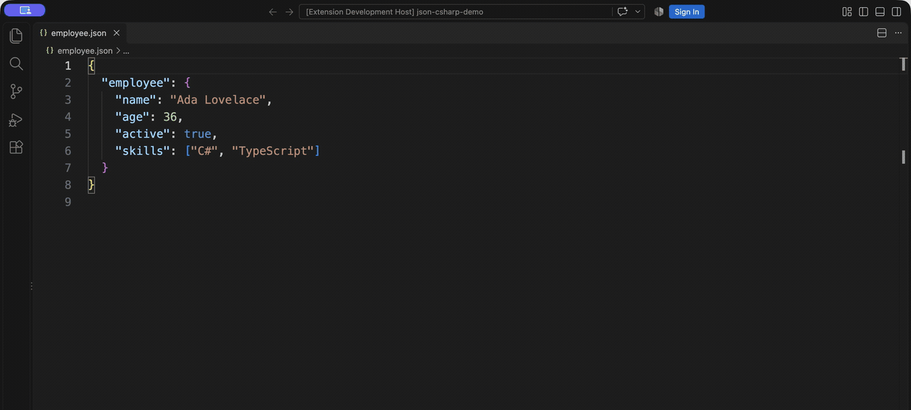

<p align="center">
  
</p>

<h1 align="center">JSON to C#</h1>
<p align="center">Turn JSON into C# classes, C# records, YAML, and XML. Right inside VS Code.</p>

<p align="center">
  <a href="https://github.com/wodsonluiz/json-to-csharp/actions/workflows/build.yml"></a>
  <a href="https://github.com/wodsonluiz/json-to-csharp/actions/workflows/build.yml"></a>
  <a href="https://github.com/wodsonluiz/json-to-csharp/releases/latest"></a>
  <a href="https://marketplace.visualstudio.com/items?itemName=wodson.json-to-csharp"></a>
</p>



## Features

- **Four outputs, one workflow.** Generate DTO classes or records, or export YAML and XML.
- **Inferred C# types.** Nested models, collections, and nullable record properties, without serialization helpers.
- **Predictable files.** Output opens beside the source; replacing an existing file requires confirmation.
- **Local conversion.** Your JSON stays in VS Code. No account, external service, or added telemetry.

## Installation

Install [JSON to C# from the Visual Studio Marketplace](https://marketplace.visualstudio.com/items?itemName=wodson.json-to-csharp), or run:

```sh
code --install-extension wodson.json-to-csharp
```

Requires VS Code **1.109.0 or later**. Conversion needs no separate .NET or Python installation.

## Usage

Save and open a `.json` file. Open the Command Palette with **Ctrl+Shift+P** (**Cmd+Shift+P** on macOS), then choose a conversion. The same commands are available in the JSON editor's context menu and by right-clicking a JSON file in Explorer.

| Command | Output for `employee.json` |
| --- | --- |
| Convert JSON to C# Class | `Employee.cs` (inferred root type name) |
| Convert JSON to C# Record | `employee.record.cs` |
| Convert JSON to YAML | `employee.yml` |
| Convert JSON to XML | `employee.xml` |

These examples use the same input shown in the demonstration:

```json
{
  "employee": {
    "name": "Ada Lovelace",
    "age": 36,
    "active": true,
    "skills": ["C#", "TypeScript"]
  }
}
```

### C# Class

Generate clean DTOs with `get; set;` properties. A single root property supplies the type name; otherwise, the source filename is used. Existing Class conversion behavior is preserved.

```csharp
public class Employee
{
    public string Name { get; set; }

    public long Age { get; set; }

    public bool Active { get; set; }

    public string[] Skills { get; set; }
}
```

### C# Record

Generate C# 9 records with `init` properties and nullable annotations. Nested models become records; optional and null values are nullable. Top-level arrays and primitives use a named record with a `Value` property. Mixed types use `object`; non-null references use `default!` initialization.

```csharp
#nullable enable

using System;
using System.Collections.Generic;

public record Employee
{
    public string Name { get; init; } = default!;
    public long Age { get; init; }
    public bool Active { get; init; }
    public string[] Skills { get; init; } = default!;
}
```

Choose either Class or Record for a given DTO type in your C# project to avoid duplicate type declarations.

### YAML

Objects, arrays, primitive values, and nesting are preserved. Quoted strings prevent implicit YAML type changes; integer literals retain their precision.

```yaml
"employee":
  "name": "Ada Lovelace"
  "age": 36
  "active": true
  "skills":
    - "C#"
    - "TypeScript"
```

### XML

A single `json` root and explicit type attributes preserve structure. Arrays use indexed `item` elements. Invalid or reserved element names are represented by escaped `name` attributes. Invalid XML 1.0 characters are rejected; input cannot introduce XML markup, DTDs, or entities.

```xml
<?xml version="1.0" encoding="utf-8"?>
<json type="object">
  <employee type="object">
    <name type="string">Ada Lovelace</name>
    <age type="number">36</age>
    <active type="boolean">true</active>
    <skills type="array">
      <item type="string" index="0">C#</item>
      <item type="string" index="1">TypeScript</item>
    </skills>
  </employee>
</json>
```

See the [complete XML mapping](docs/xml-mapping.md) for edge cases and examples.

## Development

Use Node.js **24**, .NET SDK **8** (record compilation tests), and Python **3** (security and XML tests).

```sh
npm ci --ignore-scripts
npm run build
npm test
npm run audit:security
npm run package
npm run check:vsix
```

`npm test` includes compilation and linting. Press **F5** in VS Code to launch an Extension Development Host. CI additionally runs CodeQL, source/history secret scanning, and packaged-content scanning before its required Quality gate.

The [demo capture notes](docs/demo.md) describe the real recording. Maintainers should follow the [OIDC publishing procedure](docs/publishing.md); publication requires protected main, passing checks, and approval of the `marketplace` environment.

## Contributing

[Open an issue](https://github.com/wodsonluiz/json-to-csharp/issues) before a substantial change. Branch from current main, keep PRs focused, and include conversion tests and documentation. Run the development checks above; all security checks must pass before merge. See the [support guide](SUPPORT.md) for help.

## Security

Read [SECURITY.md](SECURITY.md) for release controls, credential handling, and the time-limited development-dependency exception. Security gates reject new or unapproved findings; a passing build does not mean every dependency advisory is absent.

## License

[MIT](LICENSE) · Maintained by [Wodson Correia](https://github.com/wodsonluiz).
